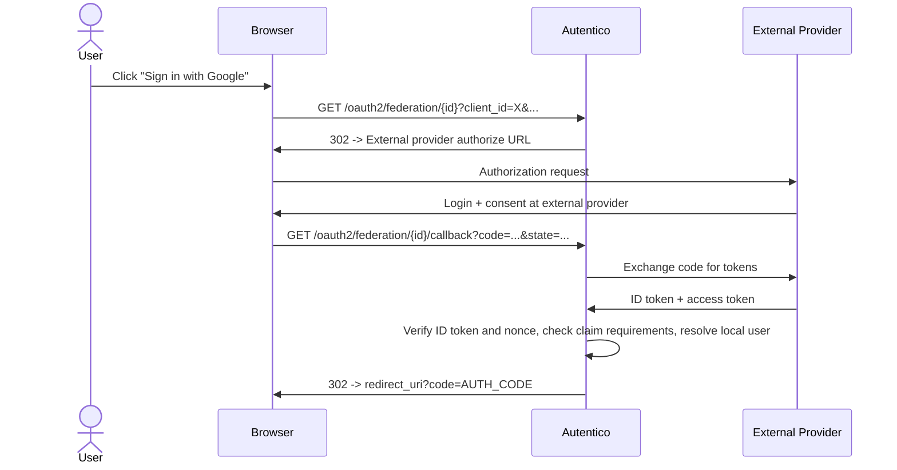

import { Aside } from '@astrojs/starlight/components';

Federation allows users to authenticate with external OIDC identity providers (such as Google, GitHub, or any OIDC-compliant provider) instead of using a local username and password. When a user logs in via a federation provider, Autentico creates or links a local user account and issues tokens as usual.

## How it works



The OAuth2 authorization parameters (client_id, redirect_uri, scope, state, code_challenge) are preserved through the federation flow using an HMAC-signed state parameter.

Federation requires an active registered client, an allowed redirect URI and scopes, and permission to use the authorization code flow. Public clients must supply PKCE; the configured S256 policy also applies. These checks run before contacting the external provider and again before issuing a local authorization code, so removing a redirect URI or disabling a client also blocks an in-progress login. Codes without a client binding cannot be exchanged.

## Browser binding and replay protection

Federated login must finish in the browser that started it. Autentico sets a separate HttpOnly browser-binding cookie and signs a random flow ID with a ten-minute deadline into upstream state. The callback must match the cookie and one pending database record; a wrong or missing cookie is rejected without consuming the initiating browser's flow.

A matching callback atomically consumes its record before upstream discovery/exchange or local account changes. Replays fail even with the original cookie, including after a server restart. Upstream/network failures after consumption require a fresh sign-in. Independent pending flows can share the browser binding, so completing one does not clear another tab's cookie.

The cookie is `__Host-autentico_federation` with Secure, Path=/ and no Domain in secure deployments, following `AUTENTICO_IDP_SESSION_SECURE`. Local HTTP development uses `autentico_federation`. Proxies and browsers must preserve this cookie through the top-level provider redirect.

Autentico also sends an independent upstream `nonce` and checks it in the verified ID token before resolving a local user. The original relying party nonce is preserved for its own ID token. Routine schema 19 adds the pending-flow table; existing credentials and TOTP enrollment are preserved. Callbacks already in flight from an older version must restart sign-in.

## Outbound network protection

Discovery, token exchange and signing-key (JWKS) requests use a restricted HTTP client. Each connection checks its resolved IP before dialing, including redirects and discovery-provided endpoint URLs. Private, loopback, link-local, unspecified, multicast and shared-address (CGNAT) destinations are blocked, including IPv4-mapped IPv6 addresses. Redirect chains are limited to five requests; the client does not use environment proxies.

Federation providers must expose reachable public endpoints. A provider configured with a private issuer can still be stored by an admin, but login fails before contacting it. The same restriction applies if a public provider's discovery document points its token or signing-key endpoint at a private address. This policy also applies after DNS changes between requests.

## Claim requirements

In **Admin → Federation Providers**, add optional claim requirements when creating or editing a provider. Every row must pass before Autentico creates or links a local account, starts a local session, or issues a code. Requirements use the verified upstream ID token after signature, issuer, audience, expiry and nonce validation. They apply to new users and already-linked identities, using the current provider configuration at callback time.

```json
[
  {"claim": "hd", "match": "equals", "value": "mycompany.com"},
  {"claim": "email_verified", "match": "equals", "value": true}
]
```

For Google Workspace, check the `hd` claim, rather than inferring membership from an email suffix; see [Google's ID token validation guidance](https://developers.google.com/identity/openid-connect/openid-connect#validatinganidtoken). For a general email filter, use a regex such as `^[^@]+@mycompany\\.com$` (JSON string syntax).

| Operator | Accepted value | Passing condition |
|---|---|---|
| `equals` | String or boolean | Same type and exactly equal, case sensitive |
| `not_equals` | String or boolean | Same type and unequal |
| `regex` | String | Go regular expression matches somewhere in the claim string |
| `not_regex` | String | Go regular expression does not match the claim string |

Missing, null and wrong-type claims fail **every** operator, including negative operators. Claim names are literal, case-sensitive top-level keys: `profile.department` does not traverse a nested object. Arrays, objects and numbers cannot satisfy a requirement. All rows must pass; `[]` adds no restrictions. Regex uses [Go syntax](https://pkg.go.dev/regexp/syntax), with search semantics; use `^` and `$` for whole-value matching. Empty regex is valid and matches any string. JavaScript lookaround and backreferences are unsupported.

Limits: 32 rows; claim names up to 256 UTF-8 bytes (no surrounding whitespace or control characters); string values up to 4096 bytes; regex patterns up to 1024 bytes; serialized requirements up to 64 KiB. The API rejects invalid rules before saving. Provider create/update bodies are limited to 256 KiB. An omitted update field preserves existing rules, an explicit `[]` clears them, and `null` is invalid. New providers default to `[]`. Omitted or blank client secrets on update preserve the existing secret.

**Test rules** evaluates the current draft against a JSON claims object without saving it. It uses the same Go matcher as login, shows each row's result in order, and rejects malformed or duplicate top-level claim names. This tests matching only: it does not verify a JWT or establish that the sample is authentic. Samples are not persisted, upstream providers are not contacted, and no accounts, sessions or tokens are created.

The admin-only API is `POST /admin/api/federation/test-claim-requirements`, with a maximum 64 KiB body:

```json
{
  "claim_requirements": [{"claim": "email_verified", "match": "equals", "value": true}],
  "claims": {"email_verified": true}
}
```

The response includes `passed` and ordered `results` with zero-based `index`, `claim`, `match`, `passed` and a safe `reason`. Logical rule errors such as `invalid_pattern` return a failed row; malformed request/sample JSON returns HTTP 400. Samples and comparison values are never included in results or denial logs. Login returns a generic failure; server diagnostics contain only the provider, row index and failure category.

Invalid or unsupported stored rules block login. The admin API exposes `claim_requirements_error: "invalid_stored_claim_requirements"`; use the editor to replace the rules or explicitly clear them. Other edits preserve the invalid policy. Schema 22 stores the ordered JSON array on `federation_providers`; no extra table or environment variable is needed. Existing providers retain their behavior with `[]`.

These are admission rules for future federated logins. They do not revoke existing sessions, restrict password/passkey/other login methods, or configure claims in Autentico-issued tokens.

## User resolution

When a user authenticates through a federation provider, Autentico resolves the local user account in this order:

1. **Existing federated identity** -- if the (provider_id, provider_sub) pair is already linked to a local user, that user is used
2. **Verified email match** -- if both the external provider and the local account have verified the same email address, the accounts are automatically linked
3. **New account** -- if no match is found, a new local user is created with a derived username and a random unusable password

<Aside type="note">
Auto-linking by email only occurs when the email is verified on both sides (the external provider reports `email_verified: true` and the local account has a verified email). This prevents account takeover via unverified email claims.
</Aside>

## Managing providers via admin API

All federation provider endpoints require admin authentication.

| Method | Endpoint | Description |
|---|---|---|
| `GET` | `/admin/api/federation` | List all providers (paginated) |
| `POST` | `/admin/api/federation` | Create a new provider |
| `POST` | `/admin/api/federation/test-claim-requirements` | Test draft rules without saving |
| `GET` | `/admin/api/federation/{id}` | Get a provider by ID |
| `PUT` | `/admin/api/federation/{id}` | Update a provider |
| `DELETE` | `/admin/api/federation/{id}` | Delete a provider |

### Create a provider

```bash
curl -X POST https://auth.example.com/admin/api/federation \
  -H "Authorization: Bearer $ADMIN_TOKEN" \
  -H "Content-Type: application/json" \
  -d '{
    "id": "google",
    "name": "Google",
    "issuer": "https://accounts.google.com",
    "client_id": "your-google-client-id",
    "client_secret": "your-google-client-secret",
    "enabled": true,
    "sort_order": 1
  }'
```

### Provider fields

| Field | Required | Description |
|---|---|---|
| `id` | Yes | Unique slug identifier (e.g. `google`, `github`). Used in URLs. |
| `name` | Yes | Display name shown on the login page |
| `issuer` | Yes | OIDC issuer URL (must support `/.well-known/openid-configuration`) |
| `client_id` | Yes | Client ID registered with the external provider |
| `client_secret` | Yes | Client secret from the external provider |
| `icon_svg` | No | SVG markup for the provider icon on the login page |
| `enabled` | No | Whether the provider is active (default: `true`) |
| `sort_order` | No | Display order on the login page (lower numbers first) |

### List providers

```bash
curl "https://auth.example.com/admin/api/federation?sort=sort_order&order=asc" \
  -H "Authorization: Bearer $ADMIN_TOKEN"
```

Supports query parameters:

| Parameter | Description |
|---|---|
| `sort` | Sort field: `name`, `issuer`, `client_id`, `sort_order`, `enabled`, `created_at` |
| `order` | Sort order: `asc` (default), `desc` |
| `search` | Search across `name`, `issuer`, `client_id` |
| `enabled` | Filter by enabled status: `1` or `0` |
| `limit` | Max results per page (1--100, default 100) |
| `offset` | Number of results to skip (default 0) |

### Update a provider

```bash
curl -X PUT https://auth.example.com/admin/api/federation/google \
  -H "Authorization: Bearer $ADMIN_TOKEN" \
  -H "Content-Type: application/json" \
  -d '{
    "name": "Google",
    "issuer": "https://accounts.google.com",
    "client_id": "updated-client-id",
    "client_secret": "updated-secret",
    "enabled": true,
    "sort_order": 1
  }'
```

### Delete a provider

```bash
curl -X DELETE https://auth.example.com/admin/api/federation/google \
  -H "Authorization: Bearer $ADMIN_TOKEN"
```

## Federation endpoints (public)

These endpoints are used during the login flow and are not authenticated.

| Method | Endpoint | Description |
|---|---|---|
| `GET` | `{oauth_path}/federation/{id}` | Start federation login (redirects to external provider) |
| `GET` | `{oauth_path}/federation/{id}/callback` | Handle callback from external provider |
| `GET` | `{oauth_path}/federation/{id}/icon` | Serve the provider's SVG icon |

### Begin federation login

The begin endpoint accepts the standard OAuth2 authorization parameters as query strings so they can be preserved through the external provider redirect:

```
GET /oauth2/federation/google?client_id=my-app&redirect_uri=https://app.example.com/callback&scope=openid+profile+email&state=abc123&code_challenge=...&code_challenge_method=S256
```

## Provider icon security

Provider icons (SVG) are served via a dedicated endpoint (`{oauth_path}/federation/{id}/icon`) with the following security measures:

- SVGs are served with `Content-Type: image/svg+xml` and loaded via `` tags, which disables script execution
- A restrictive `Content-Security-Policy` header (`default-src 'none'; style-src 'unsafe-inline'; sandbox`) is set on direct navigation
- Icons are cached with ETags and a 5-minute max-age

## Database tables

### `federation_providers` table

| Column | Type | Description |
|---|---|---|
| `id` | TEXT | Primary key (admin-chosen slug) |
| `name` | TEXT | Display name |
| `issuer` | TEXT | OIDC issuer URL |
| `client_id` | TEXT | OAuth2 client ID at the external provider |
| `client_secret` | TEXT | OAuth2 client secret |
| `icon_svg` | TEXT | SVG markup (nullable) |
| `enabled` | BOOLEAN | Whether the provider is active |
| `sort_order` | INTEGER | Display order |
| `created_at` | DATETIME | Creation timestamp |

### `federated_identities` table

| Column | Type | Description |
|---|---|---|
| `id` | TEXT | Primary key (xid) |
| `provider_id` | TEXT | Foreign key to `federation_providers.id` |
| `provider_user_id` | TEXT | The `sub` claim from the external provider |
| `user_id` | TEXT | Foreign key to `users.id` |
| `email` | TEXT | Email from the external provider (nullable) |
| `created_at` | DATETIME | When the link was created |

### `federation_login_flows` table

| Column | Type | Description |
|---|---|---|
| `flow_id` | TEXT PK | Random 256-bit identifier, also used as the independent upstream nonce |
| `browser_hash` | TEXT | SHA-256 of the separate browser binding; no raw cookie is stored |
| `state_hash` | TEXT | SHA-256 of the complete signed state |
| `expires_at` | INTEGER | Expiry in Unix seconds, indexed for cleanup |

Successful consumption deletes the record. Hashes and expiry survive restarts; expired rows follow the configured cleanup retention.

## SSRF protection

When Autentico communicates with external providers (OIDC discovery and token exchange), it uses a restricted HTTP client that:

- Blocks redirects to private/loopback IP ranges (127.0.0.0/8, 10.0.0.0/8, 172.16.0.0/12, 192.168.0.0/16, link-local, IPv6 equivalents)
- Limits the number of redirects to 5
- Enforces a 10-second timeout

This prevents SSRF attacks where a malicious issuer URL could be used to probe internal infrastructure.
