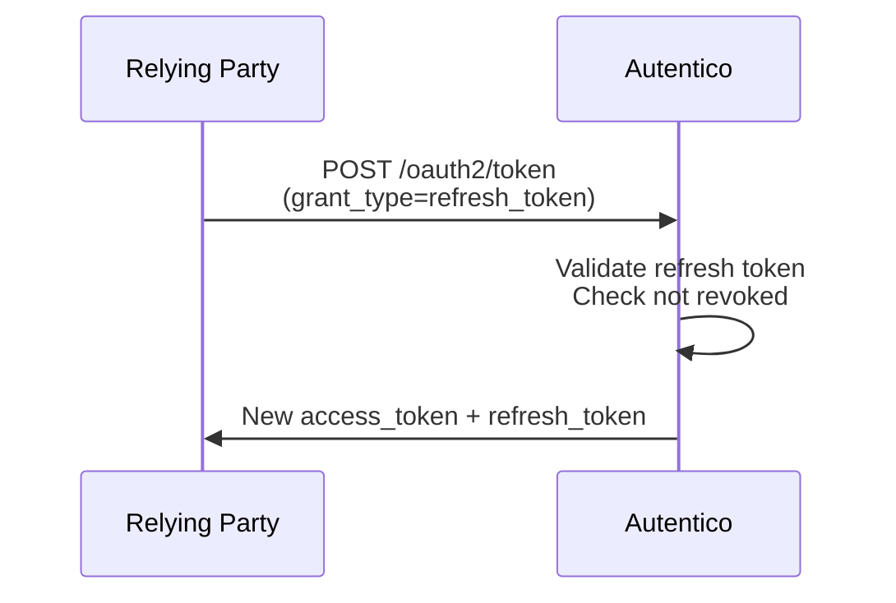

Refresh tokens allow relying parties to obtain new access tokens after the current one expires, without sending the user back through the login flow.

## Flow



## Request

```bash
curl -X POST https://auth.example.com/oauth2/token \
  -H "Content-Type: application/x-www-form-urlencoded" \
  -d "grant_type=refresh_token" \
  -d "refresh_token=YOUR_REFRESH_TOKEN" \
  -d "client_id=YOUR_CLIENT_ID"
  # Public clients identify themselves with client_id; no secret is required.
```

Every refresh request must identify the **same registered client** that received the token. Public clients send `client_id`. Confidential clients must also authenticate, using HTTP Basic authentication or `client_id` plus `client_secret` form fields. The client must be active and allow the `refresh_token` grant. PKCE verifies the initial authorization-code exchange; it does not replace confidential-client authentication during refresh.

For a confidential client using HTTP Basic authentication:

```bash
curl -X POST https://auth.example.com/oauth2/token \
  -u "YOUR_CLIENT_ID:YOUR_CLIENT_SECRET" \
  -H "Content-Type: application/x-www-form-urlencoded" \
  -d "grant_type=refresh_token" \
  -d "refresh_token=YOUR_REFRESH_TOKEN"
```

Missing client identification or invalid credentials return `invalid_client`. A token issued to another client, or an older token with no client binding, returns `invalid_grant`. Requests rejected by these checks do not rotate the token. Users holding an unbound token must sign in again; it cannot be reassigned to a client.

**Response:**

```json
{
  "access_token": "eyJhbGciOiJSUzI1NiIsInR5cCI6IkpXVCJ9...",
  "token_type": "Bearer",
  "expires_in": 900,
  "refresh_token": "eyJhbGciOiJIUzI1NiIsInR5cCI6IkpXVCJ9..."
}
```

A new refresh token is issued with each refresh. Store the new refresh token — the old one is invalidated. Send one refresh request at a time: concurrent requests using the same token have one winner, and replay detection revokes all of the user’s tokens. Rotation and replacement token/session storage commit together, so a storage failure leaves the original token available for retry. An invalid scope request also leaves it usable.

## Refresh token lifetime

The default refresh token lifetime is 30 days (`720h`). Configure globally via the `refresh_token_expiration` runtime setting, or per-client via the `refresh_token_expiration` override field.

## Revocation

Refresh tokens can be revoked explicitly via [Token Revocation](/protocol/introspection-revocation/), or implicitly when the user logs out. Revoked refresh tokens cannot be used to obtain new access tokens.
